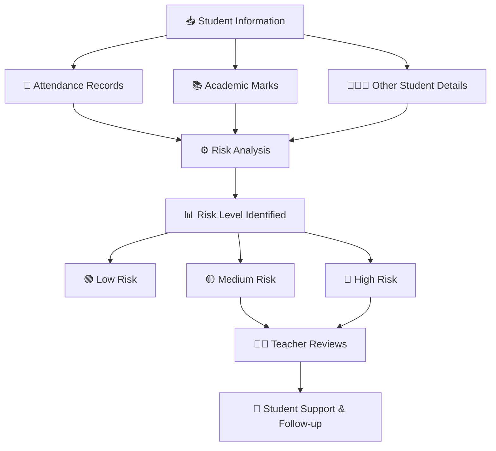
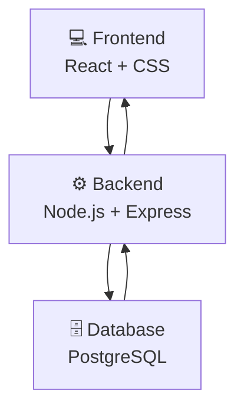

<div align="center">

# 🎓 UDAAN
### Student Retention & Early Intervention Platform

**Helping schools identify students who need support and take action at the right time.**

<br/>

[](https://react.dev/)
[](https://nodejs.org/)
[](https://expressjs.com/)
[](https://www.postgresql.org/)
[](https://vitejs.dev/)
[](LICENSE)

<br/>

🌱 **Notice Early • Support Better • Build Brighter Futures**

</div>

---

## 🌟 About Udaan

Student dropouts don't happen overnight. They often begin with small signs like irregular attendance, declining marks, or personal difficulties.

**Udaan** is a student support platform designed to help schools identify these warning signs early.

It brings student attendance, academic performance, and other important information together so teachers and school administrators can understand which students need extra attention.

Our goal is simple: **Help every student get the support they need to continue their education.**

## 💡 Why Udaan?

Schools often manage attendance, marks, and student information separately. This makes it difficult to notice when a student is struggling.

Udaan helps by:

- Bringing important student information together.
- Identifying students who may need attention.
- Showing the reasons behind risk levels.
- Helping teachers plan and track support.
- Keeping track of student progress.

---

## ✨ Key Features

| Feature | What it does |
|---|---|
| 📊 Dashboard | Displays student statistics, attendance, and important alerts. |
| 👨‍🎓 Student Management | Stores student details and academic information. |
| 📅 Attendance Tracking | Helps teachers record and view daily attendance. |
| 📚 Academic Records | Tracks student marks and academic performance. |
| ⚠️ Risk Monitoring | Identifies students who may need additional support. |
| 🎯 Intervention Tracking | Helps teachers manage support activities for students. |
| 👨‍👩‍👧 Parent Meetings | Maintains records of parent-teacher meetings. |
| 🔍 Search & Filters | Makes it easier to find students and records. |

## 🔄 How Does Udaan Work?

The platform follows a simple process:



### 📌 Understanding Risk Levels

Udaan uses a simple rule-based scoring system to identify students who may need attention.

| Risk Level | Score | Meaning |
|---|---:|---|
| 🟢 Low | 0–24 | Student is generally on track. |
| 🟡 Medium | 25–49 | Student may need closer attention. |
| 🔴 High | 50–100 | Student may need immediate support. |

**Note:** Risk scores are meant to guide teachers, not make decisions about a student's future. Every flagged student should be reviewed by school staff.

---

## 🛠️ Technologies Used

We built Udaan using the following technologies:

| Technology | Purpose |
|---|---|
| React.js | Building the user interface |
| CSS | Styling and designing the application |
| Node.js | Running the backend |
| Express.js | Handling API requests |
| PostgreSQL | Storing application data |
| Prisma | Connecting the backend to the database |
| Vite | Frontend development and build tool |
| Vercel | Application deployment |

---

## 🏗️ Basic System Architecture

The application has three main parts:



- **Frontend:** What users see and interact with.
- **Backend:** Processes requests and handles application logic.
- **Database:** Stores student, attendance, marks, and other records.

---

## 📂 Project Structure

```text
Student-Dropout-Prevention-System/
│
├── client/              # Frontend (React)
│   ├── src/
│   │   ├── components/  # Reusable UI components
│   │   ├── pages/       # Application pages
│   │   ├── services/    # API communication
│   │   ├── hooks/       # Custom React hooks
│   │   └── utils/       # Helper functions
│   └── package.json
│
├── server/              # Backend (Node.js + Express)
│   ├── prisma/          # Database schema and migrations
│   ├── src/
│   │   ├── controllers/ # Request handling
│   │   ├── routes/      # API routes
│   │   ├── services/    # Application logic
│   │   └── middleware/  # Request middleware
│   └── package.json
│
├── shared/              # Shared application logic
│   └── src/
│
├── package.json
└── README.md
```

---

## 🚀 Getting Started

Want to run Udaan on your computer? Follow these steps.

### 1. Clone the Repository

```bash
git clone https://github.com/aasthamusale/Student-Dropout-Prevention-System.git
```

```bash
cd Student-Dropout-Prevention-System
```

### 2. Install Dependencies

```bash
npm install
```

### 3. Run in Mock Mode (Without Database)

For quickly exploring the frontend without setting up a database:

```bash
cp client/.env.example client/.env.local
```

Add the following to `client/.env.local`:

```env
VITE_USE_MOCKS=true
```

Start the frontend:

```bash
npm run dev:web
```

Open **http://localhost:3000** in your browser.

### 4. Run with Database (Fullstack Mode)

To use the complete application:

- Set up a PostgreSQL database.
- Configure the environment variables in `server/.env`.
- Configure `client/.env.local`.
- Run database migrations and seed data.

```bash
npm run db:deploy
npm run db:seed
npm run dev
```

For the required database connection settings, refer to the environment variable examples in the project setup.

---

## 🌐 Live Demo

<details>
<summary><b>Click here to view demo details</b></summary>

**Live Application:** 

https://student-dropout-prevention-system.vercel.app/login

**Demo Password:** `Udaan@123`

| Role | Demo Email |
|---|---|
| School Administrator | admin@udaan.demo |
| Principal | principal@udaan.demo |
| Class Teacher | teacher@udaan.demo |
| Subject Teacher | farhan.khan@udaan.demo |

</details>

---

## 🔮 Future Improvements

We would love to expand Udaan with more useful features:

- 📱 Mobile-friendly application with offline support.
- 📩 SMS and WhatsApp notifications for parents.
- 📄 Student progress reports and report card generation.
- 🏫 Support for multiple schools.
- 📊 More detailed student performance insights.

---


<div align="center">

### 🌱 Every Student Matters.

*Built with ❤️ to help students stay connected to education.*

**UDAAN — Giving Every Student a Chance to Rise.**

</div>
